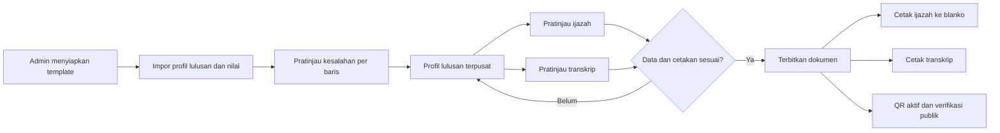

# Kebutuhan dan alur kerja

## Pengguna

- **Admin**: satu-satunya peran internal. Mengelola semua langkah, termasuk koreksi, template, penerbitan, cetak, pencabutan, dan penggantian.
- **Pengunjung publik**: membuka tautan QR untuk melihat status ijazah; tidak memiliki akun atau kemampuan mengubah data.

## Alur utama

Pemeriksaan pada simpul G dilakukan sendiri oleh Admin. Tidak ada alur persetujuan orang lain.

## Menu dan layar

| Layar | Isi dan tindakan utama |
|---|---|
| Beranda | Jumlah lulusan draf, data bermasalah, dokumen terbit, serta tautan cepat ke impor dan cetak. |
| Lulusan | Cari NIM/nama/prodi/angkatan; lihat status ijazah dan transkrip secara terpisah. |
| Detail lulusan | Satu formulir profil bersama, daftar mata kuliah/nilai, dua pratinjau, riwayat perubahan, dan tombol terbitkan. |
| Impor CSV | Unggah berkas lulusan dan nilai dalam satu proses; pemetaan kolom; pratinjau; daftar baris valid/bermasalah; simpan hanya setelah Admin memeriksa. |
| Template ijazah | Pilih prodi dan versi; atur redaksi serta posisi bidang dalam mm di atas pratinjau blanko; uji cetak. |
| Template transkrip | Atur header STIE, profil, kolom nilai, kelompok mata kuliah, ringkasan, pengesahan, dan aturan pemisahan halaman. |
| Penerbitan | Daftar dokumen siap/terbit/dibatalkan; unduh dan cetak ulang dengan catatan. |
| Verifikasi publik | Tampilkan status dan data pembanding minimum saat QR dipindai. |
| Pengaturan | Nama/alamat kampus, prodi, pejabat penandatangan, akun Admin, dan backup. |

## Perilaku yang diharapkan

1. Mengubah nama atau tempat lahir pada **draf** langsung mengubah pratinjau ijazah dan transkrip.
2. Satu lulusan boleh memiliki kedua dokumen pada status berbeda, misalnya ijazah masih draf sementara transkrip siap terbit.
3. Nilai mata kuliah disimpan sebagai baris tersendiri; identitas lulusan tidak diulang pada setiap mata kuliah dalam database.
4. Setelah terbit, dokumen mempertahankan salinan data dan versi template saat penerbitan. Koreksi berikutnya tidak mengubah dokumen lama secara diam-diam.
5. Pencetakan ulang menampilkan dokumen terbit yang sama dan mencatat pengguna, waktu, serta alasan bila diperlukan.
6. Admin dapat menandai dokumen salah sebagai dibatalkan dan menerbitkan pengganti; tautan QR lama tetap menunjukkan status pembatalannya.

## Yang tidak disediakan

- Portal mahasiswa dan akun dosen.
- Penginputan nilai semester atau penghitungan kelulusan akademik.
- Penerbitan nomor ijazah nasional melalui PISN.
- Verifikasi otomatis dengan PISN tanpa akses resmi yang tersedia.
- Klaim bahwa pemindaian QR saja membuktikan blanko fisik asli.
