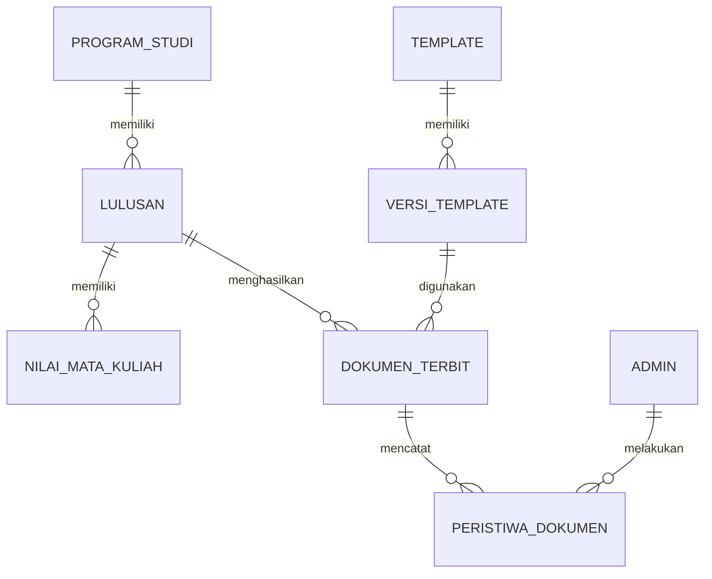

# Data terpusat dan impor CSV

## Model data konseptual



### Entitas dan bidang inti

| Entitas | Bidang penting |
|---|---|
| Lulusan | ID internal, NIM unik sebagai **teks**, nama resmi, tempat/tanggal lahir, prodi, program pendidikan, tanggal kelulusan/yudisium, nomor ijazah nasional sebagai **teks**, nomor transkrip, judul skripsi bila dipakai. |
| Nilai mata kuliah | Lulusan, kode MK, nama MK, kelompok/semester bila dipakai, SKS, nilai huruf, nilai angka/bobot bila tersedia, urutan cetak, penanda mata kuliah yang diperhitungkan. |
| Program studi | Nama resmi, kode, jenjang, gelar/singkatan, redaksi akreditasi yang berlaku, versi kurikulum bila diperlukan. |
| Template dan versi | Jenis dokumen, prodi atau umum, ukuran kertas, redaksi, aset, posisi bidang, waktu berlaku, status aktif/arsip. |
| Dokumen terbit | Jenis, nomor, lulusan, status, versi template, salinan data final, hash berkas final, token QR acak, waktu terbit, pengganti/yang diganti. |
| Peristiwa dokumen | Tindakan, Admin, waktu, alasan, ringkasan perubahan; append-only. |

**NIM dipakai untuk pencocokan impor, bukan sebagai identitas URL publik.** Dalam database relasional, ID internal tetap menjadi penghubung antartabel.

## Alur impor tunggal

Admin membuka satu layar **Impor data lulusan dan nilai**. Pada layar yang sama ia memasukkan:

1. `lulusan.csv`: satu baris per lulusan.
2. `nilai.csv`: satu baris per mata kuliah per lulusan.

Aplikasi membaca keduanya sebagai satu *batch*, mencocokkan `nim`, lalu menampilkan ringkasan sebelum commit. Dua berkas ini menjaga format CSV sederhana tanpa mengetik identitas dua kali. Impor ulang dapat **menambah** data baru atau **memperbarui draf** setelah Admin melihat perbedaan; dokumen yang sudah terbit tidak ditimpa.

### Kolom minimum yang diusulkan

`lulusan.csv`:

```text
nim,nama_lengkap,tempat_lahir,tanggal_lahir,kode_prodi,program_pendidikan,tanggal_lulus,nomor_ijazah_nasional,nomor_transkrip,tanggal_terbit,judul_skripsi
```

`nilai.csv`:

```text
nim,urutan,kode_mk,nama_mk,kelompok_mk,sks,nilai_huruf,bobot_nilai
```

Tanggal memakai ISO `YYYY-MM-DD` di CSV dan diformat ke Bahasa Indonesia saat dicetak. `nim`, `nomor_ijazah_nasional`, `nomor_transkrip`, dan `kode_mk` **tidak boleh dikonversi menjadi angka**. `bobot_nilai` dapat dikosongkan jika aplikasi diberi tabel konversi resmi; tanpa keduanya, IPK tidak boleh dinyatakan final.

### Validasi sebelum simpan

- NIM kosong/ganda, nilai dengan NIM yang tidak ada dalam batch atau database, kode MK ganda yang tidak ditandai sebagai perbaikan nilai.
- Tanggal tidak sah, nomor ijazah/transkrip yang telah dipakai, prodi yang tidak dikenal, SKS/bobot di luar rentang resmi.
- Nama atau kode mata kuliah kosong, nilai tidak dikenal, total SKS dan IPK yang tidak cocok dengan sumber akademik.
- Nomor dengan nol di depan harus tetap sama persis setelah impor dan ekspor.
- Satu kesalahan tidak menyimpan separuh batch tanpa pilihan dan laporan yang jelas. Log batch berisi jumlah berhasil, ditolak, serta alasannya.
- Saat mengekspor CSV, nilai yang diawali karakter formula spreadsheet (`=`, `+`, `-`, `@`) harus dinetralkan agar tidak dieksekusi ketika dibuka.

## Perhitungan nilai

Rumus pemeriksaan dasar: `total mutu = Σ(SKS × bobot)` dan `IPK = total mutu / total SKS yang diperhitungkan`. **Aturan resmi STIE masih diperlukan** untuk nilai ulang, mata kuliah transfer, nilai tanpa bobot, pembulatan, batas SKS, dan predikat. Aplikasi tidak menebak aturan tersebut. Jika sumber akademik menyertakan total SKS/IPK resmi, tampilkan berdampingan dengan hasil hitung dan blokir penerbitan bila berbeda di luar toleransi yang ditetapkan kampus.
