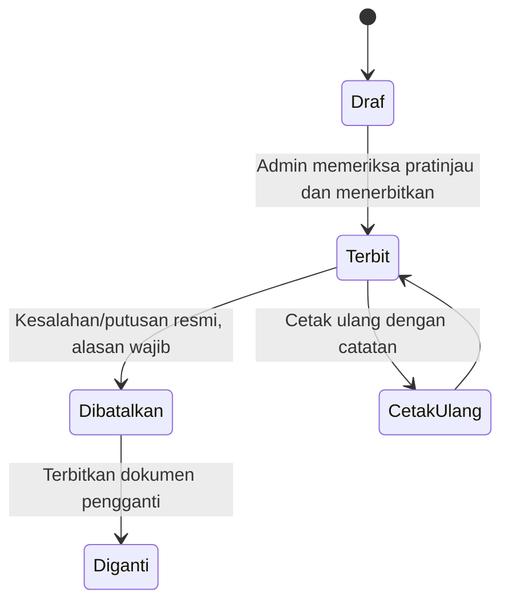

# Penerbitan, QR, dan keamanan

## Siklus dokumen

Ijazah dan transkrip memiliki status penerbitan masing-masing. Profil lulusan adalah sumber bersama sebelum penerbitan; setiap penerbitan menyimpan **snapshot** profil, nilai yang relevan, template, pejabat, waktu, dan nomor dokumen. Transaksi database memastikan nomor unik dan snapshot tersimpan bersama. Riwayat peristiwa bersifat tambah-saja (tidak ditimpa).

## QR pada ijazah

- QR berisi URL HTTPS kampus seperti `https://domain-kampus/verify/{token_acak}`. Token dihasilkan secara acak oleh sistem, panjang dan entropinya memadai, dan tidak dapat ditebak dari NIM/nomor ijazah.
- Halaman publik menampilkan **status** (`Terbit` atau `Dibatalkan/Diganti`), nama lulusan, prodi, nomor ijazah yang perlu dicocokkan dengan cetakan, serta tanggal terbit. Penyajian nomor penuh/sebagian harus disahkan kebijakan kampus; NIM ditutup sebagian jika ditampilkan.
- Halaman publik **tidak** menampilkan NIK, tanggal lahir lengkap, alamat, transkrip/nilai, foto, atau berkas pindai ijazah. Draf dan token tak dikenal memberi jawaban generik tanpa membocorkan identitas.
- Halaman tidak di-cache oleh browser/proxy dan diberi pembatasan permintaan. Log akses publik tidak menyimpan data pribadi lebih dari yang diperlukan.
- QR lama tetap membuka status `Dibatalkan` setelah penggantian; jangan mendaur ulang token.
- QR membantu mengecek **catatan penerbitan kampus**. QR bisa disalin ke kertas lain, sehingga pengguna perlu mencocokkan rincian di halaman dengan dokumen fisik. Verifikasi nasional tetap tersedia di [PISN](https://pisn.kemdiktisaintek.go.id/).

## Hak akses dan operasional

- Satu peran **Admin**, tetapi akun pribadi per petugas tetap disarankan agar riwayat menunjukkan siapa melakukan tindakan. Semua akun memiliki hak yang sama; tidak ada tahap persetujuan lintas peran.
- Login dengan kata sandi kuat, sesi yang kedaluwarsa, proteksi CSRF, dan pembatasan percobaan login. Aktifkan HTTPS untuk login dan halaman verifikasi.
- File CSV dibatasi ukuran/tipe, diproses sebagai data, dan tidak dapat menjalankan formula atau HTML. Berkas unggahan tidak dipublikasikan.
- Backup otomatis terenkripsi atau disimpan di lokasi akses terbatas; uji pemulihan berkala. Jaga database, dokumen final, dan kunci aplikasi dalam backup yang konsisten.
- Audit mencatat impor, perubahan profil, perubahan template, penerbitan, cetak ulang, pembatalan, dan penggantian.

## Validasi sebelum tombol Terbitkan aktif

1. Identitas bersama lengkap dan tidak bertentangan dengan sumber akademik.
2. Nomor ijazah nasional dari PISN telah diisi untuk ijazah; aplikasi tidak membuatnya.
3. Nomor dokumen unik dan template prodi yang tepat tersedia.
4. Untuk transkrip: mata kuliah/nilai lengkap, total dan IPK sesuai aturan STIE, dan tidak ada baris impor bermasalah.
5. Pratinjau final terbuka; Admin mengonfirmasi telah membandingkan data dengan sumber resmi. Konfirmasi ini adalah tindakan Admin sendiri, bukan peran pemeriksa tambahan.
